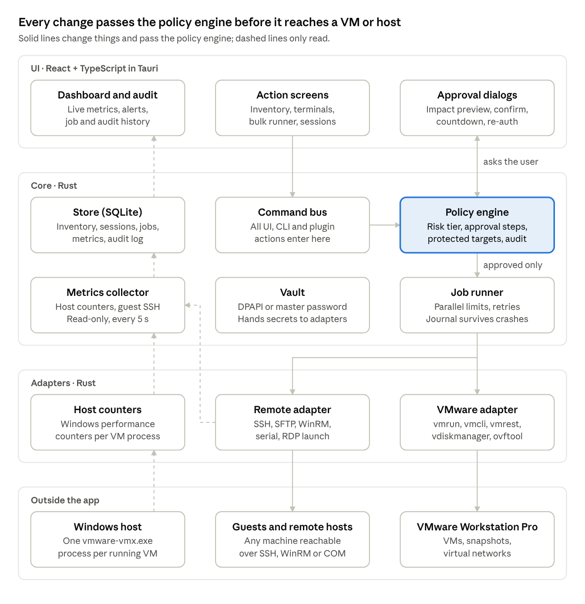
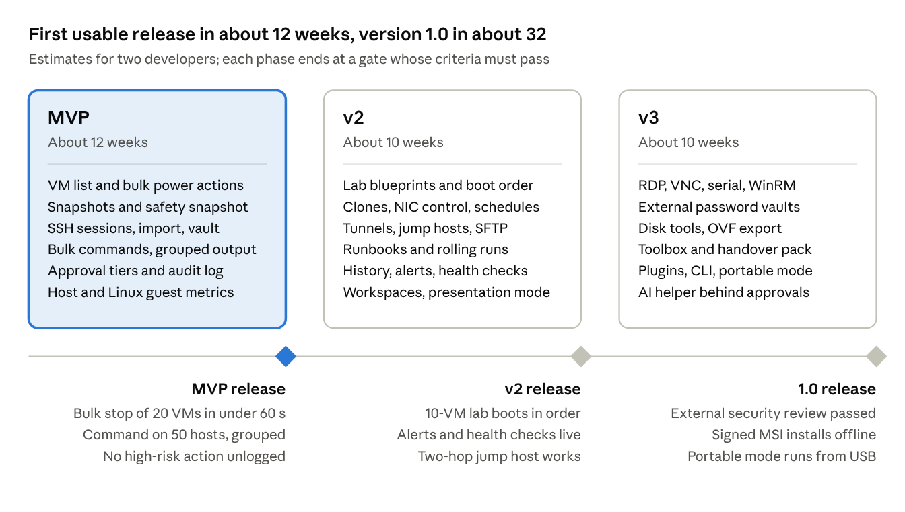

# VM & SSH Manager PRD

As of 18 Oct 2026. MVP scope locked at 32 requirements (see Decisions at the end).

A Windows desktop app for forward deployed engineers and IT admins to control VMware Workstation Pro VMs in bulk, watch their performance, and run commands on any SSH-reachable machine, with multi-step approvals on every high-impact action.

## Goals and users

The app replaces the mix of Workstation's own UI, PuTTY or MobaXterm, and ad-hoc scripts with one tool that makes bulk changes safe by default.

**Goals**

1. Control many Workstation VMs at once: power, snapshots, labs.
2. Keep SSH (later RDP, serial and WinRM) sessions in one encrypted library.
3. Run commands on many hosts and read the results grouped, not host by host.
4. Show live performance for every VM and host on one dashboard.
5. Put every high-impact action behind an approval flow and an audit log.

**Users**

| User | Typical situation | Needs most |
| --- | --- | --- |
| Forward deployed engineer | On a customer site or VPN, often offline, often screen-sharing | Jump hosts, credentials kept per customer, presentation mode, support bundles |
| IT or system admin | Runs a fleet of lab and internal servers | Bulk commands, patching, health checks, audit trail |
| Lab or demo engineer | Rebuilds labs of 5–30 VMs on one workstation | Boot order, snapshots, clones, host capacity checks |

**Success measures**

- Shut down 20 VMs, including approval, in under 60 seconds of user time.
- Run one command on 50 hosts and see grouped results within 5 seconds of the slowest host finishing.
- Import an existing PuTTY or MobaXterm session list in under 2 minutes.
- No high-risk action runs without passing the approval flow, as shown by the audit log.

**Out of scope:** VM control for ESXi, vSphere, Hyper-V, Proxmox or cloud VMs (SSH to them still works), team mode or a multi-user server, Workstation on Linux hosts, running Ansible playbooks from the app, and metric history beyond 90 days.

## VMware control

Every VM action uses tools Workstation Pro already ships: `vmrun`, the `vmrest` REST API, `vmware-vdiskmanager` and `ovftool`.

| ID | Requirement | Built on | Phase |
| --- | --- | --- | --- |
| VM-01 | Discover VMs from Workstation's library and chosen folders; show name, state, OS, CPU, RAM, IP and VMware Tools status | vmrest, `vmrun list`, .vmx parsing | MVP |
| VM-02 | Select VMs by click, shift-click, tag or saved filter; bulk start (with or without console window), stop, reset, suspend, pause, unpause | `vmrun` start, stop, reset, suspend, pause, unpause | MVP |
| VM-03 | Graceful-then-forced shutdown: soft stop, wait a set time, force off only after a separate approval | `vmrun stop` soft, then hard | MVP |
| VM-04 | Snapshot manager: bulk take, revert and delete; snapshot tree; flag snapshots older than 30 days | `vmrun` snapshot, listSnapshots, revertToSnapshot, deleteSnapshot | MVP |
| VM-05 | Safety snapshot, on by default, before any high-risk bulk action | `vmrun snapshot` | MVP |
| VM-06 | Limit parallel power-ons (default 3) to avoid host disk and CPU spikes | App job runner | MVP |
| VM-07 | Capacity check before power-on: warn when running VMs' assigned RAM would exceed host RAM, or the VM folder's disk has under 10% free | Windows APIs, `memsize` in .vmx | MVP |
| VM-08 | Lab blueprints (stacks, 0.5.0): named sets of launch templates with counts, boot order, delays and readiness checks (Tools running, SSH port open) before the next step starts; deployed and torn down as one, started and stopped in boot order | `vmrun checkToolsState`, VirtualBox Guest Additions run level, TCP probe | 0.5.0 |
| VM-09 | Run commands and copy files through VMware Tools when a VM has no network (needs the guest login) | `vmrun` runProgramInGuest, copyFileFromHostToGuest, copyFileFromGuestToHost | v2 |
| VM-10 | Full or linked clones from templates with a naming pattern; create N VMs at once | `vmrun clone` | v2 |
| VM-11 | Connect or disconnect network adapters in bulk; show virtual networks, NAT port forwards and VM IPs | vmrest | v2 |
| VM-12 | Bulk CPU and RAM changes on powered-off VMs | vmrest | v2 |
| VM-13 | Grid of live console thumbnails | `vmrun captureScreen` | v2 |
| VM-14 | Scheduled power actions and auto-suspend of idle VMs | App scheduler | v2 |
| VM-15 | VMware Tools status and bulk upgrade | `vmrun` checkToolsState, installTools | v3 |
| VM-16 | Disk tools: shrink, defragment, expand; find leftover .vmdk files no VM uses | `vmware-vdiskmanager` | v3 |
| VM-17 | Export VMs to OVF or OVA for handover | `ovftool` | v3 |

## Sessions and credentials

The session manager matches PuTTY and MobaXterm on the basics in the MVP, then adds tunnels, SFTP and more protocols.

| ID | Requirement | Phase |
| --- | --- | --- |
| SS-01 | Session library with folders, tags, colors and search; each session stores host, port, user, auth method, jump host and startup command | MVP |
| SS-02 | Import from PuTTY (registry), MobaXterm (.mxtsessions), OpenSSH config and CSV | MVP |
| SS-03 | Tabbed SSH terminal with split panes, copy-on-select, keep-alive and auto-reconnect | MVP |
| SS-04 | Encrypted vault for passwords, private keys and passphrases; unlocks with Windows login or a master password; locks after 15 minutes idle | MVP |
| SS-05 | Known-hosts manager; block the connection and warn when a host key changes | MVP |
| SS-06 | Environment label per session (Prod, Staging, Lab) shown as a colored tab; Prod raises the approval tier | MVP |
| SS-07 | Jump host chains and saved port forwards (local, remote, SOCKS) that start with the session | v2 |
| SS-08 | SFTP panel that follows the terminal's folder; drag and drop; edit a remote file locally with auto-upload | v2 |
| SS-09 | SSH key manager: generate keys, ssh-agent and Pageant support, push a public key to many hosts | v2 |
| SS-10 | Type into several open terminals at once | v2 |
| SS-11 | Timestamped session logs and terminal recording with replay | v2 |
| SS-12 | RDP (launches mstsc with saved settings), VNC, Telnet, serial/COM and WinRM sessions | v3 |
| SS-13 | External vaults: KeePass, Bitwarden, HashiCorp Vault | v3 |

## Bulk execution

The key feature is grouped output: identical results collapse into one group, so 50 hosts read like 2 or 3 answers.

| ID | Requirement | Phase |
| --- | --- | --- |
| BX-01 | Pick targets from VMs, saved sessions, tags or saved filters | MVP |
| BX-02 | Run a command or script on many hosts in parallel (default 10 at a time); show each host's output, exit code and duration | MVP |
| BX-03 | Group identical outputs ("48 hosts same, 2 differ") and show a diff between groups | MVP |
| BX-04 | Cancel a running job; retry only the hosts that failed | MVP |
| BX-05 | Export results to CSV, JSON or HTML | MVP |
| BX-06 | Detect dangerous commands (`rm -rf`, `mkfs`, `dd`, `shutdown`, `iptables -F`, `DROP DATABASE`) from an editable rule list and send them to the approval flow | MVP |
| BX-07 | Run with sudo using the password from the vault; never echo or log it | MVP |
| BX-08 | Snippet and runbook library with variables (`{{host}}`, values asked at run time) and versions per OS | v2 |
| BX-09 | Rolling runs: one test host first, set batch size, stop when failures exceed a set percentage | v2 |
| BX-10 | Bulk file upload and download with checksum check | v2 |
| BX-11 | Scheduled and recurring jobs | v2 |
| BX-12 | Export the selection as an Ansible inventory file; playbooks run outside the app | v2 |

## Approvals and audit

Every action that changes something gets one of four risk tiers, and the tier decides the approval steps. A target labelled Prod moves the action up one tier.

| Tier | Example actions | Steps before it runs |
| --- | --- | --- |
| Low | Start VMs, take a snapshot, read-only commands | None; logged only |
| Medium | Suspend or pause VMs, reset one VM, open a tunnel to a Prod host | One confirm showing the impact summary |
| High | Stop, reset or suspend 2 or more VMs; revert or delete snapshots; any command flagged dangerous | Impact preview, safety snapshot (on by default), type the number of targets, give a reason, an optional change ID (AP-08; a workspace can require one for Prod targets), 10-second countdown with cancel |
| Critical | Hard power-off, bulk network disconnect, deleting VMs or disks, any High action on Prod | All High steps, then the vault password again |

VM settings and lifecycle (0.5.0, `docs/plan-0.5.md` "Approval tiers"; a Prod-labelled VM moves each up one tier, and protected VMs are skipped):

| Action | Tier |
| --- | --- |
| Edit CPU, RAM, network cards, firmware, shared folders, the guest OS type or the name (VM off); a bulk resize is one approval | Medium |
| Attach or eject an ISO; connect a network card | Low |
| Disconnect a network card (2 or more VMs: Critical, the bulk network disconnect above) | Medium |
| Add a disk; compact or defragment a disk; install or upgrade Tools | Medium |
| Expand a disk (can't be shrunk back); upgrade the hardware version (can't be undone) | High |
| Remove a disk (deletes its files); delete a VM | Critical |
| Add an existing VM (a `.vmx` to the list, a `.vbox` to VirtualBox) | Low |
| Open a VM's console (the hypervisor's own window; it changes nothing) | No tier; audited |
| Add or remove a NAT port forward: a Workstation vmnet's, a VirtualBox NAT network's, or a VirtualBox VM's NAT adapter rule (it reaches every VM on the network; a network counts as Prod when a VM on it is) | High |
| Read a VM's logs and timeline, the host networks, the waste finder's report | No tier; not audited (reads) |

Deploy (0.5.0, `docs/plan-0.5.md` "Approval tiers"; VM-21, VM-10). Each new VM is a target, labelled as the deploy labels it, so a Prod label moves the tier up one; a new VM is never protected:

| Action | Tier |
| --- | --- |
| Deploy 1 to 4 VMs: create, clone (a VM-10 bulk clone too) or import | Medium |
| Deploy 5 or more VMs (the bulk tier for deploys, from 5 VMs by default), or VMs labelled Prod | High |
| Deploy 5 or more VMs labelled Prod | Critical |

Stacks (0.5.0, `docs/plan-0.5.md` "Approval tiers"; VM-08). A stack instance's VMs are the targets; protected VMs are skipped, and a Prod label moves each up one tier:

| Action | Tier |
| --- | --- |
| Deploy a stack: a deploy of all its VMs, made step by step in boot order (one approval) | As a deploy: Medium for 1 to 4 VMs, High for 5 or more |
| Start, shut down or suspend a stack instance (boot order to start, the last step first to stop) | The power action's own tier on its VMs (start Low; shut down or suspend Medium for one VM, High for 2 or more) |
| Tear down a stack instance (deletes the VMs its deploy made, with their files; VMs added by hand only when picked) | Critical |
| Edit a stack, or add or take a VM out of an instance by hand (nothing in a VM changes) | No tier; audited |

Conversion (0.5.0, `docs/plan-0.5.md` "Approval tiers"; CV-01 to CV-03, VM-17). The source is only read and only new files are written, so these are Low; a Prod-labelled VM moves its export up one tier, and a protected VM is skipped. An import of a foreign VM or disk is a deploy, with the deploy rows above. Inspect and Verify only read, so they are not commands:

| Action | Tier |
| --- | --- |
| Convert a disk image into a new one (CV-03) | Low |
| Export a powered-off VM for another hypervisor or a cloud (VM-17, CV-02) | Low |
| Export a VM labelled Prod | Medium |
| Import a foreign VM or disk as a new VM (CV-01) | As a deploy: Medium, High for Prod |

Workspaces (0.5.0, FD-02). A VM belongs to one workspace, and the bus refuses an action on a VM from any other. Workspace edits and moving VMs between workspaces change nothing outside Remotely:

| Action | Tier |
| --- | --- |
| Create, rename, recolour, archive or restore a workspace; switch workspaces (refused while a job started in the shown one runs) | No tier; audited, refused by the read-only lock |
| Add an unassigned VM to the shown workspace, or take one out (never a protected or Prod VM) | No tier; audited, refused by the read-only lock |
| Change the workspace's change ID rule (AP-08) | No tier; audited, refused by the read-only lock |

Schedules (0.5.0, VM-14 and VM-27, `docs/plan-0.5.md` "Approval tiers"):

| Action | Tier |
| --- | --- |
| A scheduled snapshot, start, shut down, suspend or resume, or auto-suspend of idle VMs | The action's own tier on the schedule's VMs (Prod raises it, protected VMs are skipped), approved when the schedule is saved with the same steps as running it then, AP-06 included; the countdown is each run's |
| A snapshot schedule that keeps the last N | The higher of taking and deleting a snapshot (High): retention deletes the schedule's own snapshots |
| A run after the schedule was edited, a VM became Prod or protected, got its tag or joined its stack, or the rules that rated it changed | Doesn't run: the schedule pauses and asks again |
| Creating, editing, pausing, resuming and deleting schedules; the snapshot chain warnings' limits | No tier beyond the schedule's approval; audited |

| ID | Requirement | Phase |
| --- | --- | --- |
| AP-01 | A policy engine classes every state-changing action into a tier; tier rules are editable | MVP |
| AP-02 | Impact preview: targets with current state, uptime, logged-in users and dependent VMs (once blueprints exist) | MVP |
| AP-03 | Type-to-confirm, reason field and countdown with cancel | MVP |
| AP-04 | Protected targets ("do not touch") are skipped by bulk actions until unlocked | MVP |
| AP-05 | Append-only audit log of who, what, targets, approval answers, result and output; each entry is hash-chained to the previous one so edits show; exports to CSV | MVP |
| AP-06 | Critical tier asks for the vault password again | MVP |
| AP-07 | Maintenance windows: High and Critical actions outside them need an extra override reason; Windows Hello as a re-auth option | v2 |
| AP-08 | Change IDs (0.5.0; the ID's old meaning, a second approver, was dropped with team mode): an optional ticket or change number on High and Critical approvals, standing approvals for schedules included; a setting per workspace makes it required for actions on Prod targets. Trimmed, at most 64 characters, secrets redacted; kept in the audit entry, the job, the AP-05 audit CSV and the Compare and MultiExec exports | 0.5.0 |

## Monitoring dashboard

Workstation has no per-VM metrics API, so the dashboard combines two sources:

- **Host side, no login needed:** each running VM is a `vmware-vmx.exe` process, and Windows performance counters give its CPU %, RAM and disk read/write.
- **Guest side, login needed:** CPU, memory, disk use per mount, disk I/O, network, load and uptime, read from `/proc` over SSH or `Get-Counter` over WinRM.

| ID | Requirement | Phase |
| --- | --- | --- |
| MO-01 | Host-side metrics for every running VM, refreshed every 5 seconds | MVP |
| MO-02 | Linux guest metrics over SSH | MVP |
| MO-03 | Overview grid with sorting, filters and color thresholds; drill into one VM | MVP |
| MO-04 | Host capacity panel: assigned vs physical RAM, CPU, free disk in VM folders | MVP |
| MO-05 | Windows guest metrics over WinRM | v2 |
| MO-06 | Metric history in SQLite (raw for 7 days, 1-minute averages for 90 days) with trend charts | v2 |
| MO-07 | Thresholds and alerts by desktop notification, email, or Teams or Slack webhook | v2 |
| MO-08 | Health checks: ping, TCP port, HTTP status, service status | v2 |
| MO-09 | Top processes per host; killing one goes through the approval flow | v2 |
| MO-10 | Live log view across hosts (merged, one color per host) with search | v2 |
| MO-11 | Certificate expiry, pending OS updates and disk-full forecast | v3 |
| MO-12 | On-demand metrics through VMware Tools for VMs with no network (slower) | v3 |

## FDE features and platform

These features are for work at customer sites: keeping engagements apart, sharing screens safely and handing work over.

| ID | Requirement | Phase |
| --- | --- | --- |
| FD-01 | Command palette (Ctrl+K), full keyboard use, dark and light themes | MVP |
| FD-02 | Customer workspaces (0.5.0): sessions, VMs, templates, stacks, schedules, vault items, jobs, audit log, rules and per-engagement settings kept separate per engagement; switched from the top bar; an FD-07 export holds one workspace | 0.5.0 |
| FD-03 | Presentation mode: mask IPs, hostnames, usernames and secrets on screen; optional read-only lock | v2 |
| FD-04 | Support bundle: collect logs, configs and system info from many hosts into one timestamped zip | v2 |
| FD-05 | Inventory export (OS, IPs, MACs, CPU, RAM, packages, open ports) to Excel | v2 |
| FD-06 | Markdown notes per host, linked to its credentials and runbooks | v2 |
| FD-07 | Encrypted backup, export and import of sessions, settings and vault; also how sessions are shared with teammates | v2 |
| FD-08 | Handover pack for the customer: inventory, topology diagram, job history | v3 |
| FD-09 | Toolbox: ping, traceroute, DNS lookup, port check, subnet calculator, certificate viewer, Wake-on-LAN, quick TFTP and HTTP server | v3 |
| FD-10 | Subnet discovery (ping sweep, port check) to add hosts quickly | v3 |
| FD-11 | Portable mode: runs from a USB drive with a master-password vault | v3 |
| FD-12 | PowerShell or Python plugins and a CLI for the app itself, both going through the policy engine | v3 |
| FD-13 | AI helper: plain language to command, error explanations, summaries of bulk output; always previewed and approved, never run on its own | v3 |
| FD-14 | Auto-update from the public GitHub repo's Releases: check at start and every 24 hours, show release notes, install on confirm once no job is running; every update is signature-checked; checks can be turned off for air-gapped sites | MVP |

## Non-functional requirements

The app runs on the same machine as the VMs, so it must stay light and must never leak credentials.

| Area | Requirement |
| --- | --- |
| Platform | Windows 10 and 11 (x64); VMware Workstation Pro 17 or later |
| Footprint | Under 200 MB RAM when idle; installer under 30 MB |
| Speed | Ready in under 3 seconds; a 50-VM dashboard at 5-second refresh uses under 5% host CPU |
| Scale | 500 saved sessions; bulk jobs on 200 hosts with 10–50 running at once |
| Offline | Everything except external alerts and updates works without internet; no telemetry by default |
| Security | Secrets encrypted at rest with AES-256-GCM, keyed by Windows DPAPI or an Argon2id master password; never written to logs, history or exports; signed installer |
| Audit | Every state-changing action is logged when it starts and when it ends |
| Reliability | Jobs are journaled, so after a crash the app shows which targets finished and which did not |
| Public code | The public repository holds no credentials, PII or secrets: test data uses example.com names and documentation IP ranges, secret scanning runs on every commit and push, signing keys live only in GitHub Actions secrets, and commits use a GitHub noreply email |

## Architecture



Every change passes the policy engine before it reaches a VM or host. Solid paths change things; dashed paths only read.

```text
LAYERS: UI (React + TypeScript in Tauri) -> Core (Rust) -> Adapters (Rust) -> Outside the app

WRITE PATH (changes something; every step is audited)
  Action screens (UI)
    -> Command bus
    -> Policy engine  <->  Approval dialogs (UI)
    -> Job runner                         (approved commands only)
       -> VMware adapter  -> VMware Workstation Pro   (vmrun / vmcli / vmrest)
       -> Remote adapter  -> Guests and remote hosts  (SSH / SFTP / WinRM / COM)

READ PATH (no approval needed)
  Windows host (one vmware-vmx.exe per VM) -> Host counters  -> Metrics collector
  Guests over SSH                          -> Remote adapter -> Metrics collector
  Metrics collector -> Store (SQLite) -> Dashboard and audit (UI)

SHARED
  Vault -> hands secrets to the adapters (never to the UI, never to logs)
  Policy engine, Job runner -> write the audit log and job journal to the Store
```

Component notes:

- **Command bus:** all UI, CLI and plugin actions enter here.
- **Policy engine:** risk tier, approval steps, protected targets, writes the audit log.
- **Job runner:** parallel limits, retries; its journal survives crashes.
- **Metrics collector:** host counters plus guest SSH, read-only, every 5 s.
- **Vault:** DPAPI or master password; hands secrets to adapters.
- **Store (SQLite):** inventory, sessions, jobs, metrics, audit log.
- **Remote adapter:** SSH, SFTP, WinRM, serial, RDP launch.
- **VMware adapter:** vmrun, vmcli, vmrest, vdiskmanager, ovftool.

**Design rules**

- **One way in for changes.** The UI, CLI, plugins and the AI helper all submit commands to the command bus, so approvals and audit cannot be skipped.
- **Reads skip approval.** Metrics and inventory reads go straight to the store, which keeps the dashboard fast.
- **Workspace ID on every record from day one,** so customer workspaces (FD-02) need no data migration later.
- **The app runs `vmrest` itself** on localhost with generated credentials from the vault, and falls back to `vmrun` if it is unavailable.
- **One adapter per outside system,** so a Workstation update changes one module.

## Tech stack

Recommended: **Tauri 2 with a Rust core and a React + TypeScript UI**. It keeps the app small on a machine whose RAM belongs to the VMs, and Rust's async runtime handles hundreds of parallel SSH sessions.

| Layer | Choice | Why |
| --- | --- | --- |
| App shell | Tauri 2 | Uses Windows' built-in WebView2; small installer, low idle RAM |
| UI | React, TypeScript, Vite | Large component ecosystem for tables, forms and dashboards |
| Terminal | xterm.js | The terminal inside VS Code; handles colors, resizing and links |
| Charts | uPlot | Draws thousands of live points cheaply |
| Core | Rust with the tokio runtime | Safe concurrency for bulk jobs and metric polling |
| SSH and SFTP | russh, russh-sftp | Async Rust; supports jump-host channels and port forwards |
| VMware | `vmrun` and `vmcli` as child processes; `vmrest` over HTTP | Only the interfaces VMware documents |
| Host metrics | Windows performance counters via the `windows` crate | Per-process CPU, memory and I/O for each `vmware-vmx.exe` |
| WinRM | PowerShell remoting started from the host | The host is Windows, so no extra library is needed |
| Storage | SQLite in WAL mode via sqlx | One local file for inventory, jobs, metrics and audit; no server |
| Secrets | DPAPI via the `windows` crate; Argon2id + AES-256-GCM | Tied to the Windows login by default; master password for portable mode |
| Serial | serialport crate | COM console access to network gear |
| RDP | Launch `mstsc.exe` with a generated .rdp file | Native client; no embedded control to maintain |
| Packaging | Signed installer from the Tauri bundler; the Tauri updater pulls releases from the public GitHub repo | Every update is signature-checked; auto-check can be turned off at air-gapped sites |
| CI/CD | GitHub Actions with tauri-action | Tests and secret-scans every push; builds and publishes signed releases on version tags |

**Alternatives considered**

| Option | Best when | Trade-off |
| --- | --- | --- |
| .NET 9 + WPF + WebView2 (xterm.js) | The team already writes C#, or RDP must run in an embedded tab | Windows only; SSH.NET needs manual port-forward chaining for jump hosts |
| Electron + Node (ssh2) | Fastest start; most terminal-app examples use it | Typically 150–300 MB RAM when idle, taken from the VMs |

## Roadmap



| Phase | Estimate | Scope | Exit gate |
| --- | --- | --- | --- |
| MVP | About 12 weeks | VM list and bulk power actions; snapshots and safety snapshot; SSH sessions, import, vault; bulk commands with grouped output; approval tiers and audit log; host and Linux guest metrics; auto-update from GitHub Releases | Bulk stop of 20 VMs in under 60 s; command on 50 hosts with grouped output; no high-risk action unlogged |
| v2 | About 10 weeks | Lab blueprints and boot order; clones, NIC control, schedules; tunnels, jump hosts, SFTP; runbooks and rolling runs; history, alerts, health checks; workspaces, presentation mode | 10-VM lab boots in order; alerts and health checks live; two-hop jump host works |
| v3 | About 10 weeks | RDP, VNC, serial, WinRM; external password vaults; disk tools, OVF export; toolbox and handover pack; plugins, CLI, portable mode; AI helper behind approvals | External security review passed; signed MSI installs offline; portable mode runs from USB |

Each phase sums up the requirements tagged with that phase in the tables above; the MVP is locked at 32 requirements, including auto-update (FD-14). Durations assume two full-time developers; revisit them after the first 4 weeks.

## Risks and decisions

The largest risk is guest access: most rich features need a login inside each VM, so credential setup must be quick.

| Risk | Impact | Mitigation |
| --- | --- | --- |
| Guest metrics and Tools commands need a login for every VM | Gaps on the dashboard | Credential profiles applied by tag; host-side metrics always work |
| `vmrest` is not running by default and needs a one-time credential setup | No inventory or network control | The app starts `vmrest` on localhost with generated credentials kept in the vault, and falls back to `vmrun` |
| `vmrun` guest calls take seconds each | Too slow for live metrics | Use them only on demand; poll over SSH or WinRM |
| Windows guests have no SSH by default | No guest metrics or commands | WinRM support, plus a one-click script that enables OpenSSH Server |
| Broadcom changes Workstation's tools or licensing | Features break after an update | All VMware calls behind one adapter, tested against each new release |
| The app holds keys to many systems | A stolen laptop exposes customers | Encrypted vault, auto-lock, per-customer workspaces, no secrets in logs |
| The team may not know Rust | Slower MVP | Use the .NET option with the same architecture |
| A secret or customer detail is committed to the public repo | Leaked credentials or customer data | Secret scanning before every commit and in CI, GitHub push protection, example.com test data, app data stored outside the repo folder |
| A bad release reaches every machine | All installs break at once | Releases start as drafts and are published only after a smoke test; the updater rejects unsigned files |
| The update-signing key is lost | Installed apps can't verify new updates and need a manual reinstall | Back up the key and its password in a password manager |

**Decisions**

| Question | Decision | Effect on this PRD |
| --- | --- | --- |
| Single user or team mode? | Single user only | AP-08 (second approver) removed; sessions are shared through encrypted export (FD-07) |
| Host platforms and Workstation versions? | Windows 10 and 11, Workstation Pro 17 and later | Linux hosts running Workstation are out of scope |
| Embedded RDP or launch mstsc? | Launch mstsc | SS-12 unchanged, stays in v3 |
| Ansible scope? | Runbooks plus inventory export | BX-12 is now inventory export only, moved to v2 |
| Is the MVP scope final? | Locked on 18 Oct 2026 at the 31 requirements marked MVP | Moving a row into or out of MVP needs a new decision in this table |
| Where do the code and updates live? | One public GitHub repo for code and releases; installed apps update from its Releases | FD-14 (auto-update) added to MVP, now 32 requirements; new rule: no credentials, PII or secrets in the code |
